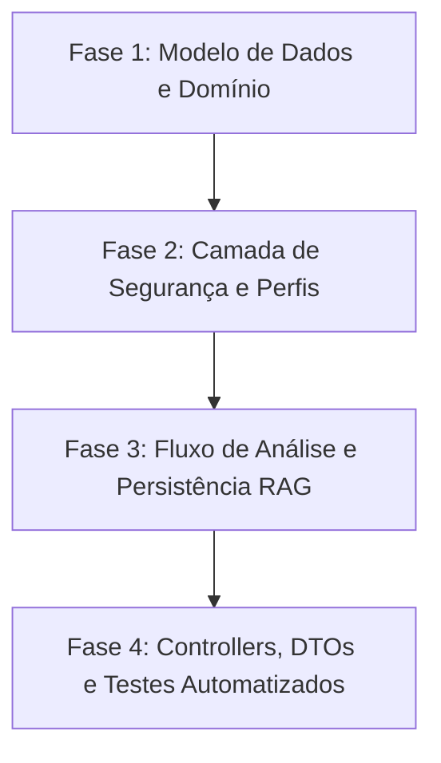

# Análise de Aderência e Plano de Ação: Regras da Aplicação de Análise de Crédito

> **Documento de Referência:** [`docs/definicao-da-aplicacao.md`](file:///home/almir/projetos/credit-analysis-rag/docs/definicao-da-aplicacao.md)  
> **Data da Avaliação:** 28 de Outubro de 2026  
> **Status Geral de Aderência:** 🟡 **Parcialmente Aderente (55%)**

---

## 1. Sumário Executivo

Foi realizada uma análise minuciosa entre os requisitos estabelecidos na especificação de negócio ([`definicao-da-aplicacao.md`](file:///home/almir/projetos/credit-analysis-rag/docs/definicao-da-aplicacao.md)) e a implementação atual do projeto `credit-analysis-rag` (código-fonte Spring Boot, Spring AI, modelos relacionais PostgreSQL e base vetorial pgvector).

A aplicação possui uma base técnica funcional para a parte de vetorização de regras de negócio com pgvector e integração com IA via RAG. Contudo, foram identificadas **divergências críticas de arquitetura e regras de negócio**, especialmente no controle de acesso (ausência do perfil de Cliente), validação cadastral (criação automática de clientes inexistentes em vez de validação), e não persistência das solicitações reprovadas no banco relacional PostgreSQL.

---

## 2. Matriz de Aderência Detalhada

| Seção do Documento | Requisito / Regra | Status Atual | Evidência no Código |
| :--- | :--- | :---: | :--- |
| **2. Perfis: Cliente (Customer)** | Gestão Cadastral própria (CRUD no PostgreSQL) | 🔴 **Não Aderente** | O controller [`CustomerController`](file:///home/almir/projetos/credit-analysis-rag/src/main/java/com/credit/analysis/controller/CustomerController.java#L13-L14) está sob `/api/operators/customers` e [`SecurityConfig`](file:///home/almir/projetos/credit-analysis-rag/src/main/java/com/credit/analysis/config/SecurityConfig.java#L25) restringe a `OPERATOR` e `ADMIN`. O papel `ROLE_CUSTOMER` não existe na segurança. |
| **2. Perfis: Cliente (Customer)** | Submeter solicitações para análise de crédito | 🔴 **Não Aderente** | [`SecurityConfig`](file:///home/almir/projetos/credit-analysis-rag/src/main/java/com/credit/analysis/config/SecurityConfig.java#L25) restringe `/api/credit-analysis/**` a `OPERATOR` e `ADMIN`. O cliente final não possui permissão para disparar o endpoint. |
| **2. Perfis: Admin** | Gestão de Regras de Negócio em pgvector | 🟢 **Aderente** | [`BusinessRuleController`](file:///home/almir/projetos/credit-analysis-rag/src/main/java/com/credit/analysis/controller/BusinessRuleController.java#L13-L14) restrito a `ADMIN`, com CRUD e geração de embeddings no pgvector. |
| **2. Perfis: Admin** | Disparar e consultar análises de crédito | 🟢 **Aderente** | Usuário `admin` tem role `ADMIN` e acesso liberado a [`/api/credit-analysis/**`](file:///home/almir/projetos/credit-analysis-rag/src/main/java/com/credit/analysis/config/SecurityConfig.java#L25). |
| **3.1. Armazenamento** | PostgreSQL: Cadastro de clientes (CRUD) | 🟢 **Aderente** | Tabela `customers` modelada em [`V1__init.sql`](file:///home/almir/projetos/credit-analysis-rag/src/main/resources/db/migration/V1__init.sql#L13-L23) e mapeada na entidade [`Customer`](file:///home/almir/projetos/credit-analysis-rag/src/main/java/com/credit/analysis/domain/entity/Customer.java). |
| **3.1. Armazenamento** | PostgreSQL: Histórico e registro de pedidos (Aprovados e Reprovados com motivos) | 🔴 **Não Aderente** | Em [`RAGCreditAnalysisService.java`](file:///home/almir/projetos/credit-analysis-rag/src/main/java/com/credit/analysis/service/RAGCreditAnalysisService.java#L74-L76), quando o crédito é incompatível, lança `CreditIncompatibleException` antes de persistir. As **solicitações reprovadas não são gravadas no PostgreSQL**. |
| **3.1. Armazenamento** | pgvector: Regras e políticas de crédito com embeddings para busca contextual | 🟢 **Aderente** | Tabela `business_rules` com coluna `embedding vector(1536)` e busca por similaridade de cosseno em [`BusinessRuleRepository`](file:///home/almir/projetos/credit-analysis-rag/src/main/java/com/credit/analysis/repository/BusinessRuleRepository.java#L16-L23). |
| **3.2. Fluxo: Início** | Análise pode ser iniciada por Customer ou Admin | 🟡 **Parcialmente Aderente** | Apenas Admin (e Operator) pode iniciar. Customer não tem perfil nem rota liberada. |
| **3.2. Fluxo: Entrada** | Parâmetros: CPF, Valor de Crédito Solicitado, Salário Atual | 🟢 **Aderente** | DTO [`CreditApplicationRequestDTO`](file:///home/almir/projetos/credit-analysis-rag/src/main/java/com/credit/analysis/domain/dto/CreditApplicationRequestDTO.java) possui exatamente os 3 campos requeridos. |
| **3.2. Fluxo: Validação** | Validação Cadastral: CPF com cadastro ativo no PostgreSQL | 🔴 **Não Aderente** | Em vez de validar se o cliente existe e está ativo, [`RAGCreditAnalysisService`](file:///home/almir/projetos/credit-analysis-rag/src/main/java/com/credit/analysis/service/RAGCreditAnalysisService.java#L52-L60) **cria automaticamente** um cliente fictício caso o CPF não exista. Não há verificação de cadastro ativo. |
| **3.2. Fluxo: RAG** | Busca semântica (*Retrieval*) no pgvector | 🟢 **Aderente** | Realiza busca por similaridade em [`businessRuleService.findSimilarRules`](file:///home/almir/projetos/credit-analysis-rag/src/main/java/com/credit/analysis/service/RAGCreditAnalysisService.java#L63) recuperando o contexto das regras. |
| **3.2. Fluxo: Agente** | Agente de IA analisa valor vs salário vs regras de crédito | 🟡 **Parcialmente Aderente** | A IA é consultada, mas há uma validação estática via regex ([`findMaxRatioFromRules`](file:///home/almir/projetos/credit-analysis-rag/src/main/java/com/credit/analysis/service/RAGCreditAnalysisService.java#L114-L120)) que pode rejeitar a análise antes de consultar a IA. Se a IA falhar com exceção, o código aprova silenciosamente. |
| **3.2. Fluxo: Aprovado** | Registra aprovação no PostgreSQL e retorna sucesso | 🟢 **Aderente** | Salva em `credit_analysis` com status `APPROVED` e retorna [`CreditApplicationResponseDTO`](file:///home/almir/projetos/credit-analysis-rag/src/main/java/com/credit/analysis/domain/dto/CreditApplicationResponseDTO.java). |
| **3.2. Fluxo: Reprovado** | Retorna notificação de recusa com motivação detalhada baseada nas regras | 🔴 **Não Aderente** | Retorna erro HTTP 402 com mensagem curta genérica `"valor solicitado incompativel com salario"`, sem detalhar a motivação das regras avaliadas nem parecer do agente. |

---

## 3. Diagnóstico dos Pontos Críticos (GAPs)

### GAP 1: Inexistência do Perfil e Fluxo do Cliente (Customer)
- **Problema:** A aplicação foi modelada com base em dois perfis: `ADMIN` e `OPERATOR` (legado de [`docs/regras_de_conceder_credito.md`](file:///home/almir/projetos/credit-analysis-rag/docs/regras_de_conceder_credito.md)). O documento de definição estabelece que o **Customer** gerencia seu próprio cadastro e submete solicitações de crédito.
- **Impacto:** Um cliente real não consegue se autenticar, gerenciar seus dados cadastrais ou solicitar crédito.

### GAP 2: Criação Fictícia de Cliente ao invés de Validação Cadastral Ativa
- **Problema:** Linha 52-60 de [`RAGCreditAnalysisService.java`](file:///home/almir/projetos/credit-analysis-rag/src/main/java/com/credit/analysis/service/RAGCreditAnalysisService.java#L52-L60):
  ```java
  Customer customer = customerRepository.findByCpf(cleanCpf)
          .or(() -> customerRepository.findByCpf(rawCpf))
          .orElseGet(() -> customerRepository.save(Customer.builder()
                  .name("Cliente " + (cleanCpf.isEmpty() ? "Solicitante" : cleanCpf))
                  .cpf(...)
                  .email(...)
                  .birthDate(LocalDate.of(1990, 1, 1))
                  .build()));
  ```
- **Impacto:** Viola o requisito: *"Verifica se o CPF informado possui cadastro ativo no banco PostgreSQL"*. Se o cliente não existir ou não estiver ativo, a solicitação deveria ser recusada/impedida, e não inventar um cadastro fictício. Além disso, a entidade `Customer` não possui campo indicativo de status cadastral ativo (ex: `Boolean active` ou `CustomerStatus status`).

### GAP 3: Solicitações Reprovadas Não São Registradas no PostgreSQL
- **Problema:** Em [`RAGCreditAnalysisService.java`](file:///home/almir/projetos/credit-analysis-rag/src/main/java/com/credit/analysis/service/RAGCreditAnalysisService.java#L74-L76):
  ```java
  boolean compatible = evaluateCreditCompatibility(...);
  if (!compatible) {
      throw new CreditIncompatibleException("valor solicitado incompativel com salario");
  }
  ```
- **Impacto:** O banco relacional PostgreSQL **nunca armazena o histórico de recusas** no endpoint `/solicitar`. O requisito exige explicitamente: *"Histórico e registro dos pedidos/solicitações de crédito avaliados (status de aprovação/reprovação e motivos)"*.

### GAP 4: Ausência da Motivação Detalhada da Recusa na Resposta
- **Problema:** Quando a análise é reprovada, o sistema dispara a exceção tratada no [`GlobalExceptionHandler.java`](file:///home/almir/projetos/credit-analysis-rag/src/main/java/com/credit/analysis/exception/GlobalExceptionHandler.java#L17-L24), gerando HTTP 402 com apenas `{"message": "valor solicitado incompativel com salario"}`.
- **Impacto:** O solicitante não recebe a explicação detalhada de quais regras de crédito foram violadas (ex: comprometimento de renda, limite de múltiplo salarial, tempo de serviço, etc.), descumprindo a especificação: *"Apresenta e detalha a motivação da recusa com base nas regras avaliadas"*.

---

## 4. Plano de Ação Recomendado

Para adequar 100% da aplicação às diretrizes de [`docs/definicao-da-aplicacao.md`](file:///home/almir/projetos/credit-analysis-rag/docs/definicao-da-aplicacao.md), recomenda-se a execução do plano em 4 fases:



---

### Fase 1: Atualização do Modelo Cadastral e Domínio
1. **Adicionar Status Cadastral ao Cliente:**
   - Criar migração Flyway `V2__add_status_to_customers.sql` adicionando a coluna `active BOOLEAN DEFAULT TRUE NOT NULL` na tabela `customers`.
   - Atualizar a entidade [`Customer.java`](file:///home/almir/projetos/credit-analysis-rag/src/main/java/com/credit/analysis/domain/entity/Customer.java) com o atributo `active` (ou `status`).
2. **Tornar `income_data_id` opcional ou criar registro correspondente para análise simplificada:**
   - Na tabela `credit_analysis`, a coluna `income_data_id` é `NOT NULL REFERENCES income_data(id)`. Como o fluxo simplificado possui apenas `salario`, garantir que o registro de renda resumido persista a informação de renda ou ajustar a foreign key para comportar análises diretas de solicitação de crédito.

---

### Fase 2: Segurança, Perfis e Permissões
1. **Configurar Perfil `CUSTOMER`:**
   - Atualizar [`SecurityConfig.java`](file:///home/almir/projetos/credit-analysis-rag/src/main/java/com/credit/analysis/config/SecurityConfig.java) para adicionar o papel `ROLE_CUSTOMER` além de `ROLE_ADMIN` (e deprecar ou reorganizar `ROLE_OPERATOR` conforme necessário).
2. **Definir Rotas e Permissões Específicas:**
   - `/api/customer/me/**` ou `/api/customers/profile`: Permitir que o usuário com role `CUSTOMER` consulte e altere seu próprio cadastro no PostgreSQL.
   - `/api/credit-analysis/request` ou `/api/credit-analysis/apply`: Permitir que tanto `CUSTOMER` quanto `ADMIN` submetam solicitações de análise de crédito.
   - `/api/admin/**`: Restrito exclusivamente a `ADMIN`.

---

### Fase 3: Reformulação do Fluxo da Análise de Crédito (RAG & Agente)
1. **Validação Cadastral Prévia:**
   - No método `applyForCredit`, buscar o cliente pelo CPF.
   - Se o cliente não existir ou `active == false`, rejeitar imediatamente com erro cadastral (ex: `CustomerNotFoundException` / HTTP 404 ou 422: *"Cliente não possui cadastro ativo no sistema"*), **removendo o código que auto-cria cliente fictício**.
2. **Agente de IA e Detalhamento da Avaliação:**
   - Estruturar a interação com o LLM para retornar JSON estruturado ou formato parseável contendo:
     - Decisão (`APPROVED` / `REJECTED`).
     - Limite aprovado (se aplicável).
     - Motivação detalhada e regras citadas (ex: *"Crédito solicitado de R$ 3.000,00 excede a diretriz de limite máximo de 33% da renda mensal para o salário informado de R$ 1.000,00"*).
3. **Persistência Integral no PostgreSQL:**
   - **Tanto aprovações quanto reprovações devem ser persistidas** na tabela `credit_analysis` com:
     - `status`: `APPROVED` ou `REJECTED`.
     - `analysis_details`: motivação completa da aprovação ou recusa.
     - `rag_context`: regras recuperadas no pgvector.
     - `ai_response`: resposta bruta do agente.
4. **Padronização da Resposta de Retorno:**
   - Retornar objeto [`CreditApplicationResponseDTO`](file:///home/almir/projetos/credit-analysis-rag/src/main/java/com/credit/analysis/domain/dto/CreditApplicationResponseDTO.java) preenchido em ambos os cenários (HTTP 200 OK com status `REJECTED` e motivação detalhada, ou tratamento adequado sem perder o registro na base de dados).

---

### Fase 4: Atualização dos Testes Automatizados e Documentação
1. **Atualizar Testes Unitários e de Integração:**
   - Atualizar [`CreditAnalysisControllerTest.java`](file:///home/almir/projetos/credit-analysis-rag/src/test/java/com/credit/analysis/controller/CreditAnalysisControllerTest.java) e [`RAGCreditAnalysisServiceTest.java`](file:///home/almir/projetos/credit-analysis-rag/src/test/java/com/credit/analysis/service/RAGCreditAnalysisServiceTest.java) para cobrir:
     - Solicitação feita por Customer e por Admin.
     - Tentativa de análise com CPF sem cadastro ativo (deve falhar).
     - Análise reprovada gravando no repositório `credit_analysis` com o motivo detalhado.
     - Análise aprovada gravando com status `APPROVED`.
2. **Configuração de Execução de Testes com Java 21+:**
   - Ajustar configuração do Maven Surefire Plugin no [`pom.xml`](file:///home/almir/projetos/credit-analysis-rag/pom.xml) com `<argLine>-XX:+EnableDynamicAgentLoading</argLine>` para compatibilidade completa com Mockito nas versões modernas do OpenJDK.
