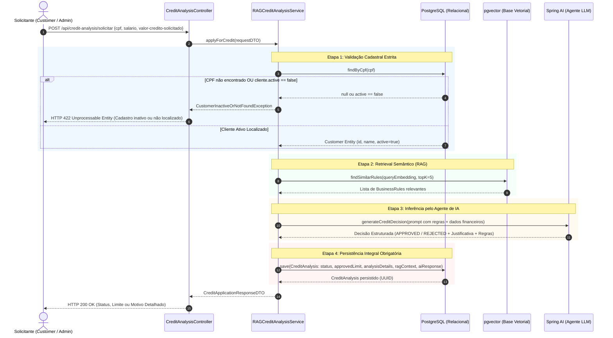
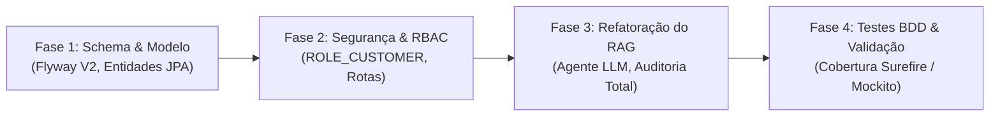

# Especificação Técnica: Spec-Driven Development (SDD)
## Sistema de Análise de Crédito com IA (RAG & Agentes)

> **Documento de Origem e Diagnóstico:** [`docs/analise-aderencia-e-plano-de-acao.md`](file:///home/almir/projetos/credit-analysis-rag/docs/analise-aderencia-e-plano-de-acao.md)  
> **Documento de Requisitos de Negócio:** [`docs/definicao-da-aplicacao.md`](file:///home/almir/projetos/credit-analysis-rag/docs/definicao-da-aplicacao.md)  
> **Versão da Especificação:** 1.0.0  
> **Data:** 28 de Outubro de 2026  
> **Status:** Aprovado para Implementação  

---

## 1. Visão Geral e Objetivos do Sistema

### 1.1. Propósito
Este documento estabelece a especificação formal orientada por especificações (*Spec-Driven Development*) para o sistema `credit-analysis-rag`. O sistema automatiza a concessão e recusa de crédito financeiro combinando:
1. **Banco de Dados Relacional (PostgreSQL)** para gestão cadastral de clientes e trilha de auditoria completa de solicitações de crédito.
2. **Base Vetorial (pgvector)** para armazenamento e indexação semântica de regras e políticas de crédito dinâmicas.
3. **Agente de IA e Pipeline RAG (*Retrieval-Augmented Generation*)** baseado em Spring AI para avaliar solicitações confrontando parâmetros financeiros com o contexto de regras normativas recuperadas.

### 1.2. Metas de Negócio e Engenharia
- **Trilha de Auditoria Integral**: 100% das análises (aprovadas e reprovadas) devem ser persistidas de forma imutável no PostgreSQL com seu respectivo parecer e contexto vetorial utilizado.
- **Rigor Cadastral**: Impedir a análise e concessão para solicitantes sem cadastro prévio ativo, eliminando a auto-criação de registros fictícios.
- **Explicabilidade das Decisões**: As recusas devem fornecer um parecer claro, detalhado e fundamentado nas cláusulas normativas recuperadas pelo RAG.
- **Isolamento de Papéis (RBAC)**: Segregação estrita entre clientes (`CUSTOMER`) e administradores (`ADMIN`).

---

## 2. Perfis de Acesso e Matriz de Permissões (RBAC)

O sistema opera com autenticação HTTP Basic (extensível a JWT/OAuth2) e papéis baseados em Spring Security.

### 2.1. Definição dos Papéis
- **`ROLE_CUSTOMER` (Cliente)**:
  - Pode consultar e atualizar seu próprio perfil cadastral.
  - Pode submeter solicitações de crédito para o seu próprio CPF.
  - Pode consultar o histórico das suas próprias solicitações de crédito.
- **`ROLE_ADMIN` (Administrador)**:
  - Gestão completa das regras de negócio (CRUD e indexação vetorial no pgvector).
  - Pode disparar solicitações de crédito para qualquer CPF cadastrado.
  - Pode consultar relatórios e históricos globais de análises de crédito.

### 2.2. Matriz de Endpoints e Autorização

| Método | Endpoint | Papel Mínimo Requerido | Descrição Funcional |
| :--- | :--- | :--- | :--- |
| `POST` | `/api/credit-analysis/solicitar` | `ROLE_CUSTOMER`, `ROLE_ADMIN` | Submissão de análise de crédito |
| `GET` | `/api/credit-analysis/history/{customerId}` | `ROLE_CUSTOMER` (próprio id), `ROLE_ADMIN` | Consulta histórico de análises |
| `GET` | `/api/customers/me` | `ROLE_CUSTOMER` | Consulta do cadastro do cliente autenticado |
| `PUT` | `/api/customers/me` | `ROLE_CUSTOMER` | Atualização cadastral do cliente autenticado |
| `GET` | `/api/admin/customers` | `ROLE_ADMIN` | Listagem geral de clientes cadastrados |
| `POST` | `/api/admin/customers` | `ROLE_ADMIN` | Cadastro administrativo de novos clientes |
| `PUT` | `/api/admin/customers/{id}/status` | `ROLE_ADMIN` | Ativação/Inativação de cadastro de cliente |
| `POST` | `/api/admin/rules` | `ROLE_ADMIN` | Cadastro de nova regra de crédito com embedding |
| `GET` | `/api/admin/rules` | `ROLE_ADMIN` | Consulta de regras de negócio cadastradas |
| `DELETE`| `/api/admin/rules/{id}` | `ROLE_ADMIN` | Exclusão de regra e remoção do índice vetorial |

---

## 3. Especificação do Fluxo de Análise de Crédito (RAG)

### 3.1. Diagrama de Sequência do Sistema (SSD)



---

## 4. Especificações Funcionais Detalhadas

### 4.1. Validação Cadastral Prévia
- **Regra**: O sistema **não deve** criar clientes em tempo de execução durante a análise de crédito.
- **Critério**: O CPF informado deve ser sanitizado (apenas números, 11 dígitos) e consultado no repositório `CustomerRepository`.
- **Condições de Recusa Imediata**:
  - CPF não encontrado na base de dados -> Lança `CustomerNotFoundException`.
  - Campo `active == false` -> Lança `CustomerInactiveException`.
- **Código HTTP**: Ambas resultam em `HTTP 422 Unprocessable Entity` com mensagem descritiva:
  ```json
  {
    "timestamp": "2026-10-28T11:45:00Z",
    "status": 422,
    "error": "Unprocessable Entity",
    "message": "Solicitante não possui cadastro ativo na instituição. Regularize seu cadastro antes de solicitar crédito."
  }
  ```

### 4.2. Busca Vetorial de Regras de Crédito (pgvector)
- **Embedding Model**: Text Embedding Ada-002 ou Gemini Embedding Model com dimensão `1536` (ou `768` conforme configuração ativa).
- **Métrica de Distância**: Similaridade de Cosseno (`<=>`).
- **Query de Contexto**: A consulta vetorial deve usar como texto de entrada:  
  `"Análise de crédito para renda mensal de R$ {salario} e valor pretendido de R$ {valorCreditoSolicitado}"`.
- **Top-K**: Recuperar as top 5 regras com corte de similaridade (`cosine_similarity >= 0.70`).

### 4.3. Agente de Análise e Avaliação de Crédito (Spring AI)
- **Prompt do Sistema**: Deve impor neutralidade e rigor analítico com base exclusiva nas regras recuperadas.
- **Formato de Saída (JSON Schema Forçado)**:
  ```json
  {
    "decision": "APPROVED | REJECTED",
    "approved_limit": 1500.00,
    "rationale": "Justificativa minuciosa citando as regras aplicadas e índices calculados",
    "violated_rules": ["Nome da Regra 1", "Nome da Regra 2"]
  }
  ```
- **Fallback / Validação de Resiliência**: Caso o serviço de IA esteja indisponível, a transação deve ser abortada com status `PENDING_REVIEW` ou retornar erro `503 Service Unavailable`, nunca aprovando silenciosamente sem conferência.

### 4.4. Trilha de Auditoria e Persistência de Dados
- **Obrigatoriedade**: Nenhuma solicitação pode terminar sem inserção correspondente na tabela `credit_analysis`.
- **Campos Mandatórios Gravados**:
  - `customer_id`: Identificador do cliente ativo.
  - `status`: `APPROVED` ou `REJECTED`.
  - `approved_limit`: Valor concedido (se aprovado) ou `0.00` (se rejeitado).
  - `analysis_details`: Parecer analítico detalhado.
  - `rag_context`: Conteúdo textual exato das regras injetadas no prompt.
  - `ai_response`: Resposta bruta emitida pelo modelo de linguagem.

---

## 5. Especificação do Modelo de Dados e Migrações (Flyway)

### 5.1. Migração Flyway: `V2__add_status_and_relax_income_fk.sql`

```sql
-- 1. Adicionar status ativo na tabela de clientes
ALTER TABLE customers 
ADD COLUMN IF NOT EXISTS active BOOLEAN DEFAULT TRUE NOT NULL;

-- 2. Permitir que income_data_id seja nulo na análise de crédito simplificada 
-- ou criar chave relacional flexível
ALTER TABLE credit_analysis 
ALTER COLUMN income_data_id DROP NOT NULL;

-- 3. Adicionar colunas de valor solicitado e renda declarada para histórico autônomo
ALTER TABLE credit_analysis 
ADD COLUMN IF NOT EXISTS requested_amount DECIMAL(15,2),
ADD COLUMN IF NOT EXISTS declared_income DECIMAL(15,2);

-- 4. Índice para busca de clientes ativos por CPF
CREATE INDEX IF NOT EXISTS idx_customers_cpf_active ON customers (cpf, active);
```

### 5.2. Mapeamento de Entidades JPA

#### Entidade `Customer`:
```java
@Entity
@Table(name = "customers")
@Getter @Setter @NoArgsConstructor @AllArgsConstructor @Builder
public class Customer {
    @Id
    @GeneratedValue(strategy = GenerationType.UUID)
    private UUID id;

    @Column(nullable = false)
    private String name;

    @Column(nullable = false, unique = true, length = 11)
    private String cpf;

    @Column(nullable = false)
    private String email;

    private String phone;
    private LocalDate birthDate;
    private String address;

    @Column(nullable = false)
    @Builder.Default
    private Boolean active = true;

    @CreationTimestamp
    private LocalDateTime createdAt;
    
    @UpdateTimestamp
    private LocalDateTime updatedAt;
}
```

#### Entidade `CreditAnalysis`:
```java
@Entity
@Table(name = "credit_analysis")
@Getter @Setter @NoArgsConstructor @AllArgsConstructor @Builder
public class CreditAnalysis {
    @Id
    @GeneratedValue(strategy = GenerationType.UUID)
    private UUID id;

    @ManyToOne(fetch = FetchType.LAZY)
    @JoinColumn(name = "customer_id", nullable = false)
    private Customer customer;

    @ManyToOne(fetch = FetchType.LAZY)
    @JoinColumn(name = "income_data_id", nullable = true)
    private IncomeData incomeData;

    @Enumerated(EnumType.STRING)
    @Column(nullable = false, length = 50)
    private CreditStatus status;

    @Column(name = "requested_amount", precision = 15, scale = 2)
    private BigDecimal requestedAmount;

    @Column(name = "declared_income", precision = 15, scale = 2)
    private BigDecimal declaredIncome;

    @Column(name = "approved_limit", precision = 15, scale = 2)
    private BigDecimal approvedLimit;

    @Column(name = "analysis_details", columnDefinition = "TEXT")
    private String analysisDetails;

    @Column(name = "rag_context", columnDefinition = "TEXT")
    private String ragContext;

    @Column(name = "ai_response", columnDefinition = "TEXT")
    private String aiResponse;

    @CreationTimestamp
    private LocalDateTime createdAt;
}
```

---

## 6. Especificação dos Contratos de API (REST DTOs)

### 6.1. Endpoint: Solicitação de Crédito
- **URI**: `POST /api/credit-analysis/solicitar`
- **Consumes**: `application/json`
- **Produces**: `application/json`

#### Payload de Requisição (`CreditApplicationRequestDTO`):
```json
{
  "cpf": "12345678901",
  "salario": 3500.00,
  "valor-credito-solicitado": 7000.00
}
```

#### Payload de Resposta - Cenário Aprovado (`CreditApplicationResponseDTO`):
- **HTTP Status**: `200 OK`
```json
{
  "analysisId": "a1b2c3d4-e5f6-7a8b-9c0d-1e2f3a4b5c6d",
  "customerId": "f7e6d5c4-b3a2-1098-7654-3210fedcba98",
  "customerName": "Maria Silva Santos",
  "cpf": "12345678901",
  "salario": 3500.00,
  "valorCreditoSolicitado": 7000.00,
  "approvedLimit": 7000.00,
  "status": "APPROVED",
  "message": "Crédito aprovado com sucesso.",
  "analysisDetails": "Aprovado: O comprometimento de renda mensal estimado em 18% respeita o teto de 30% estipulado na Regra Normativa Geral de Crédito."
}
```

#### Payload de Resposta - Cenário Reprovado (`CreditApplicationResponseDTO`):
- **HTTP Status**: `200 OK` (Com status de negócio `REJECTED` registrado no PostgreSQL)
```json
{
  "analysisId": "e9d8c7b6-a5f4-3210-fedc-ba9876543210",
  "customerId": "f7e6d5c4-b3a2-1098-7654-3210fedcba98",
  "customerName": "Maria Silva Santos",
  "cpf": "12345678901",
  "salario": 1200.00,
  "valorCreditoSolicitado": 8000.00,
  "approvedLimit": 0.00,
  "status": "REJECTED",
  "message": "Crédito reprovado de acordo com as políticas vigentes.",
  "analysisDetails": "Reprovado: O valor solicitado de R$ 8.000,00 excede em 6.6x o salário mensal comprovado de R$ 1.200,00. A Regra de Concessão Básica limita a concessão a no máximo 3.0x a renda para clientes com perfil inicial."
}
```

---

## 7. Critérios de Aceitação e Casos de Teste (Spec BDD / Gherkin)

### Cenário 1: Solicitação com CPF inexistente ou inativo
```gherkin
Funcionalidade: Validação cadastral prévia
  Como solicitante de crédito
  Quero que meus dados cadastrais sejam verificados antes da análise
  Para assegurar a conformidade e integridade operacional

  Cenário: Solicitante sem cadastro na base
    Dado que o CPF "99988877766" não existe na tabela "customers"
    Quando é feita uma requisição POST para "/api/credit-analysis/solicitar" com esse CPF
    Então o sistema deve responder com HTTP 422 Unprocessable Entity
    E o corpo da resposta deve conter "Cadastro inativo ou não localizado"
    E nenhuma linha nova deve ser criada na tabela "customers"
    E nenhuma análise deve ser persistida na tabela "credit_analysis"

  Cenário: Solicitante com cadastro inativo
    Dado que o CPF "11122233344" existe na tabela "customers" com "active = false"
    Quando é feita uma requisição POST para "/api/credit-analysis/solicitar" com esse CPF
    Então o sistema deve responder com HTTP 422 Unprocessable Entity
    E o corpo da resposta deve conter "Cadastro inativo ou não localizado"
```

### Cenário 2: Análise de crédito reprovada com persistência e parecer fundamentado
```gherkin
Funcionalidade: Reprevação com persistência de auditoria
  Como administrador ou cliente solicitante
  Quero receber a motivação detalhada da recusa
  E ter o registro gravado para auditoria futura

  Cenário: Solicitação incompatível com as regras vigentes
    Dado que o cliente "João Lima" possui cadastro ativo com CPF "22233344455"
    E existem regras no pgvector determinando teto de 33% da renda
    Quando ele submete solicitação com salário R$ 1.000,00 e valor de crédito R$ 10.000,00
    Então o sistema deve consultar as regras via busca vetorial no pgvector
    E o agente LLM deve avaliar e emitir parecer desfavorável
    E a tabela "credit_analysis" DEVE conter um novo registro com:
      | status           | REJECTED                                                 |
      | customer_id      | ID de João Lima                                          |
      | approved_limit   | 0.00                                                     |
      | analysis_details | Deve conter citação do teto de renda vs valor pretendido |
      | rag_context      | Deve conter os fragmentos das regras recuperadas         |
    E a resposta da API deve retornar HTTP 200 OK com status "REJECTED" e o parecer detalhado
```

### Cenário 3: Análise de crédito aprovada
```gherkin
Funcionalidade: Aprovação de crédito aderente
  Cenário: Solicitação compatível com limites cadastrados
    Dado que o cliente "Clara Mendes" possui cadastro ativo com CPF "33344455566"
    Quando ela submete solicitação com salário R$ 10.000,00 e crédito R$ 2.000,00
    Então o agente LLM deve emitir parecer favorável
    E a tabela "credit_analysis" deve registrar status "APPROVED" com limite "2000.00"
    E a resposta da API deve retornar HTTP 200 OK com status "APPROVED"
```

---

## 8. Matriz de Rastreabilidade (GAPs vs Especificações)

| GAP Identificado no Diagnóstico | Requisito da Especificação (SDD) | Componentes Afetados | Verificação de Sucesso |
| :--- | :--- | :--- | :--- |
| **GAP 1**: Inexistência do Perfil e Fluxo `Customer` | Seção 2: Configuração de `ROLE_CUSTOMER` e rotas liberadas | [`SecurityConfig`](file:///home/almir/projetos/credit-analysis-rag/src/main/java/com/credit/analysis/config/SecurityConfig.java), [`CustomerController`](file:///home/almir/projetos/credit-analysis-rag/src/main/java/com/credit/analysis/controller/CustomerController.java) | Cliente consegue autenticar e submeter solicitações em `/solicitar`. |
| **GAP 2**: Criação Fictícia de Cliente no Fluxo | Seção 4.1: Validação prévia de existência e `active == true`, sem auto-save | [`RAGCreditAnalysisService`](file:///home/almir/projetos/credit-analysis-rag/src/main/java/com/credit/analysis/service/RAGCreditAnalysisService.java) | Tentativa com CPF novo retorna HTTP 422 e não insere na tabela `customers`. |
| **GAP 3**: Solicitações Reprovadas Não Registradas | Seção 4.4: Persistência obrigatória de reprovações com status `REJECTED` | [`RAGCreditAnalysisService`](file:///home/almir/projetos/credit-analysis-rag/src/main/java/com/credit/analysis/service/RAGCreditAnalysisService.java), `CreditAnalysisRepository` | Registro salvo em banco mesmo quando o crédito for negado. |
| **GAP 4**: Ausência de Motivação Detalhada na Recusa | Seção 4.3 e 6.1: Retorno de parecer analítico estruturado com regras violadas | DTOs de resposta, Prompt do Agente LLM | Resposta HTTP traz campo `analysisDetails` com a fundamentação da recusa. |

---

## 9. Plano de Implementação em Fases



1. **Fase 1**: Criar `V2__add_status_and_relax_income_fk.sql` e atualizar [`Customer.java`](file:///home/almir/projetos/credit-analysis-rag/src/main/java/com/credit/analysis/domain/entity/Customer.java) e [`CreditAnalysis.java`](file:///home/almir/projetos/credit-analysis-rag/src/main/java/com/credit/analysis/domain/entity/CreditAnalysis.java).
2. **Fase 2**: Ajustar [`SecurityConfig.java`](file:///home/almir/projetos/credit-analysis-rag/src/main/java/com/credit/analysis/config/SecurityConfig.java) com papéis `CUSTOMER` e `ADMIN`.
3. **Fase 3**: Refatorar [`RAGCreditAnalysisService.java`](file:///home/almir/projetos/credit-analysis-rag/src/main/java/com/credit/analysis/service/RAGCreditAnalysisService.java) removendo auto-criação de cliente, forçando persistência em caso de reprovação e estruturando o parecer do agente LLM.
4. **Fase 4**: Atualizar testes unitários e de integração em [`RAGCreditAnalysisServiceTest.java`](file:///home/almir/projetos/credit-analysis-rag/src/test/java/com/credit/analysis/service/RAGCreditAnalysisServiceTest.java) e [`CreditAnalysisControllerTest.java`](file:///home/almir/projetos/credit-analysis-rag/src/test/java/com/credit/analysis/controller/CreditAnalysisControllerTest.java).
