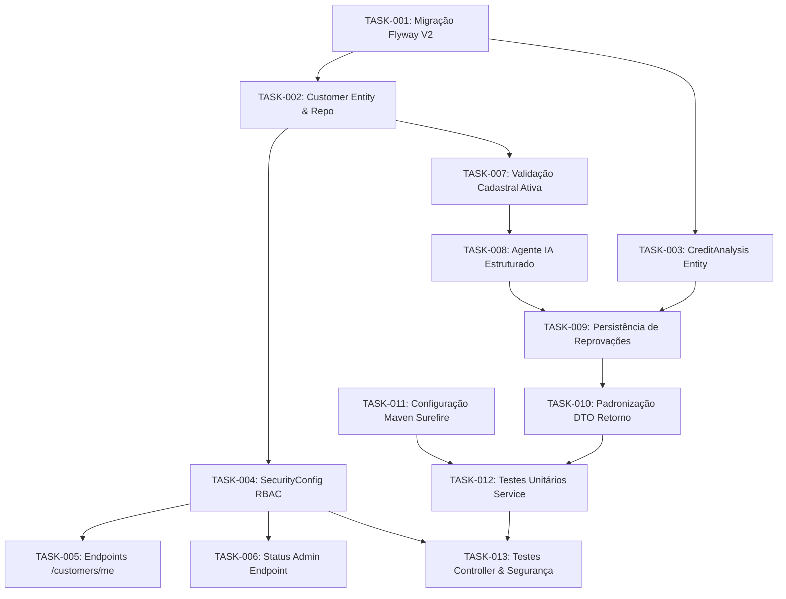

# Backlog de Tasks de Implementação: Spec-Driven Development
## Sistema de Análise de Crédito com IA (RAG & Agentes)

> **Documento de Especificação Base:** [`docs/spec-driven-development.md`](file:///home/almir/projetos/credit-analysis-rag/docs/spec-driven-development.md)  
> **Documento de Diagnóstico:** [`docs/analise-aderencia-e-plano-de-acao.md`](file:///home/almir/projetos/credit-analysis-rag/docs/analise-aderencia-e-plano-de-acao.md)  
> **Data:** 28 de Outubro de 2026  
> **Status:** 🟢 **100% Implementado e Validado**  

---

## 1. Visão Geral e Progresso das Tarefas

| Épico / Fase | Descrição | Tasks Totais | Concluídas | Status |
| :--- | :--- | :---: | :---: | :---: |
| **Épico 1: Dados & Domínio** | Migrações Flyway e entidades JPA (`Customer`, `CreditAnalysis`) | 3 | 3 | 🟢 Concluído |
| **Épico 2: Segurança & RBAC** | Perfil `CUSTOMER`, autorização de rotas e controller de cliente | 3 | 3 | 🟢 Concluído |
| **Épico 3: RAG & Motor de Análise** | Validação cadastral ativa, parecer LLM e persistência de reprovações | 4 | 4 | 🟢 Concluído |
| **Épico 4: Testes & CI/CD** | Testes unitários, de integração BDD e configuração Surefire | 3 | 3 | 🟢 Concluído |
| **Total** | **Plano Completo de Adequação** | **13** | **13** | **100% Concluído** |

---

## 2. Épico 1: Modelo de Dados e Domínio (Fase 1)

### 📌 TASK-001: Criar Script de Migração Flyway `V2`
- **Prioridade:** 🔴 Crítica (Bloqueante)
- **Referência SDD:** Seção 5.1
- **Arquivos Afetados:**
  - `src/main/resources/db/migration/V2__add_status_and_relax_income_fk.sql` (novo)
- **Descrição da Tarefa:**
  Criar a migração `V2` no Flyway para:
  1. Adicionar coluna `active BOOLEAN DEFAULT TRUE NOT NULL` na tabela `customers`.
  2. Alterar a coluna `income_data_id` na tabela `credit_analysis` para permitir valores `NULL` (desacoplando o fluxo resumido de crédito de uma renda cadastrada completa prévia).
  3. Adicionar colunas `requested_amount DECIMAL(15,2)` e `declared_income DECIMAL(15,2)` na tabela `credit_analysis`.
  4. Criar índice composto `idx_customers_cpf_active` na tabela `customers (cpf, active)`.
- **Critérios de Aceite:**
  - [x] Arquivo criado no diretório `src/main/resources/db/migration/`.
  - [x] Script DDL executa sem erros na inicialização da aplicação pelo Flyway.
  - [x] Registros já existentes recebem `active = true` por padrão.

---

### 📌 TASK-002: Atualizar Entidade JPA `Customer` e Repositório
- **Prioridade:** 🔴 Crítica
- **Referência SDD:** Seção 5.2
- **Arquivos Afetados:**
  - [`src/main/java/com/credit/analysis/domain/entity/Customer.java`](file:///home/almir/projetos/credit-analysis-rag/src/main/java/com/credit/analysis/domain/entity/Customer.java)
  - [`src/main/java/com/credit/analysis/repository/CustomerRepository.java`](file:///home/almir/projetos/credit-analysis-rag/src/main/java/com/credit/analysis/repository/CustomerRepository.java)
  - [`src/main/java/com/credit/analysis/domain/dto/CustomerDTO.java`](file:///home/almir/projetos/credit-analysis-rag/src/main/java/com/credit/analysis/domain/dto/CustomerDTO.java)
- **Descrição da Tarefa:**
  1. Mapear o atributo `@Column(nullable = false) @Builder.Default private Boolean active = true;` em `Customer.java`.
  2. Adicionar método de consulta no repositório: `Optional<Customer> findByCpfAndActiveTrue(String cpf);`.
  3. Atualizar o `CustomerDTO` para expor o campo `active`.
- **Critérios de Aceite:**
  - [x] Atributo `active` devidamente mapeado com getters/setters e builder.
  - [x] Repositório possui método para buscar clientes ativos por CPF.
  - [x] Compilação limpa sem quebra de código existente.

---

### 📌 TASK-003: Atualizar Entidade JPA `CreditAnalysis`
- **Prioridade:** 🔴 Crítica
- **Referência SDD:** Seção 5.2
- **Arquivos Afetados:**
  - [`src/main/java/com/credit/analysis/domain/entity/CreditAnalysis.java`](file:///home/almir/projetos/credit-analysis-rag/src/main/java/com/credit/analysis/domain/entity/CreditAnalysis.java)
- **Descrição da Tarefa:**
  1. Alterar a associação `@JoinColumn(name = "income_data_id", nullable = true)` permitindo nulo.
  2. Adicionar campos:
     - `@Column(name = "requested_amount", precision = 15, scale = 2) private BigDecimal requestedAmount;`
     - `@Column(name = "declared_income", precision = 15, scale = 2) private BigDecimal declaredIncome;`
- **Critérios de Aceite:**
  - [x] Entidade reflete os novos campos e permite salvar análise sem `IncomeData` obrigatório.

---

## 3. Épico 2: Segurança, Perfis e RBAC (Fase 2)

### 📌 TASK-004: Configurar Papel `ROLE_CUSTOMER` no Spring Security
- **Prioridade:** 🔴 Crítica (GAP 1)
- **Referência SDD:** Seção 2 e Matriz RBAC
- **Arquivos Afetados:**
  - [`src/main/java/com/credit/analysis/config/SecurityConfig.java`](file:///home/almir/projetos/credit-analysis-rag/src/main/java/com/credit/analysis/config/SecurityConfig.java)
- **Descrição da Tarefa:**
  1. Cadastrar usuário padrão para testes com perfil `CUSTOMER` no `UserDetailsService` (ex: `customer` / `customer123`).
  2. Reestruturar os matchers de autorização:
     - `/api/credit-analysis/solicitar`, `/api/credit-analysis/request`: Liberado para `CUSTOMER` e `ADMIN`.
     - `/api/credit-analysis/history/**`: Liberado para `CUSTOMER` e `ADMIN`.
     - `/api/customers/me/**`: Exclusivo para `CUSTOMER`.
     - `/api/admin/**`: Exclusivo para `ADMIN`.
     - Manter compatibilidade com `/api/operators/**` apontando para `ADMIN` ou `OPERATOR`.
- **Critérios de Aceite:**
  - [x] Usuário com role `CUSTOMER` autentica com sucesso via HTTP Basic.
  - [x] Usuário com role `CUSTOMER` tem permissão de POST em `/api/credit-analysis/solicitar`.
  - [x] Acesso a rotas administrativas por `CUSTOMER` retorna HTTP 403 Forbidden.

---

### 📌 TASK-005: Endpoints de Gestão Cadastral do Cliente (`/api/customers/me`)
- **Prioridade:** 🟡 Alta
- **Referência SDD:** Seção 2.2
- **Arquivos Afetados:**
  - [`src/main/java/com/credit/analysis/controller/CustomerController.java`](file:///home/almir/projetos/credit-analysis-rag/src/main/java/com/credit/analysis/controller/CustomerController.java)
  - [`src/main/java/com/credit/analysis/service/CustomerService.java`](file:///home/almir/projetos/credit-analysis-rag/src/main/java/com/credit/analysis/service/CustomerService.java)
- **Descrição da Tarefa:**
  1. Criar endpoints no `CustomerController`:
     - `GET /api/customers/me`: Retorna os dados do cliente autenticado (identificado pelo username/CPF do `Authentication Principal`).
     - `PUT /api/customers/me`: Permite atualizar telefone, endereço e e-mail cadastrado.
  2. Implementar métodos correspondentes no `CustomerService`.
- **Critérios de Aceite:**
  - [x] Cliente consegue visualizar e alterar os seus próprios dados cadastrais.
  - [x] Não permite alterar CPF nem status `active` pelo endpoint `/me`.

---

### 📌 TASK-006: Endpoint Administrativo de Gestão de Status de Clientes
- **Prioridade:** 🟢 Média
- **Referência SDD:** Seção 2.2
- **Arquivos Afetados:**
  - [`src/main/java/com/credit/analysis/controller/CustomerController.java`](file:///home/almir/projetos/credit-analysis-rag/src/main/java/com/credit/analysis/controller/CustomerController.java)
  - [`src/main/java/com/credit/analysis/service/CustomerService.java`](file:///home/almir/projetos/credit-analysis-rag/src/main/java/com/credit/analysis/service/CustomerService.java)
- **Descrição da Tarefa:**
  1. Criar endpoint `PUT /api/admin/customers/{id}/status?active=true/false` restrito a `ROLE_ADMIN` para ativar ou inativar clientes na base.
- **Critérios de Aceite:**
  - [x] Apenas administradores conseguem inativar cadastros de clientes.

---

## 4. Épico 3: Refatoração do RAG e Motor de Análise de Crédito (Fase 3)

### 📌 TASK-007: Remover Criação Fictícia e Implementar Validação Cadastral Ativa
- **Prioridade:** 🔴 Crítica (GAP 2)
- **Referência SDD:** Seção 4.1
- **Arquivos Afetados:**
  - [`src/main/java/com/credit/analysis/service/RAGCreditAnalysisService.java`](file:///home/almir/projetos/credit-analysis-rag/src/main/java/com/credit/analysis/service/RAGCreditAnalysisService.java)
  - `src/main/java/com/credit/analysis/exception/CustomerNotFoundException.java` (novo)
  - `src/main/java/com/credit/analysis/exception/CustomerInactiveException.java` (novo)
  - [`src/main/java/com/credit/analysis/exception/GlobalExceptionHandler.java`](file:///home/almir/projetos/credit-analysis-rag/src/main/java/com/credit/analysis/exception/GlobalExceptionHandler.java)
- **Descrição da Tarefa:**
  1. No método `applyForCredit`, remover completamente o bloco `orElseGet(() -> customerRepository.save(...))`.
  2. Sanitizar o CPF (remover caracteres não numéricos).
  3. Buscar cliente por CPF:
     - Se não existir, lançar `CustomerNotFoundException("CPF informado não possui cadastro no sistema")`.
     - Se existir mas `active == false`, lançar `CustomerInactiveException("Cadastro do cliente encontra-se inativo")`.
  4. Configurar `GlobalExceptionHandler` para tratar ambas as exceções retornando `HTTP 422 Unprocessable Entity` com JSON estruturado.
- **Critérios de Aceite:**
  - [x] Requisição com CPF desconhecido não cria cliente na tabela `customers` e responde com HTTP 422.
  - [x] Requisição com cliente inativo responde com HTTP 422.
  - [x] Requisição com cliente ativo segue normalmente para o fluxo de análise.

---

### 📌 TASK-008: Implementar Agente de Decisão Estruturada com Spring AI
- **Prioridade:** 🔴 Crítica (GAP 4)
- **Referência SDD:** Seção 4.3
- **Arquivos Afetados:**
  - [`src/main/java/com/credit/analysis/service/RAGCreditAnalysisService.java`](file:///home/almir/projetos/credit-analysis-rag/src/main/java/com/credit/analysis/service/RAGCreditAnalysisService.java)
  - `src/main/java/com/credit/analysis/domain/dto/AIDecisionResult.java` (novo DTO interno de parsing)
- **Descrição da Tarefa:**
  1. Criar classe interna ou DTO `AIDecisionResult` contendo:
     - `CreditStatus decision` (`APPROVED` ou `REJECTED`)
     - `BigDecimal approvedLimit`
     - `String rationale` (explicação detalhada da regra violada ou atendida)
  2. Atualizar o prompt enviado ao ChatClient / ChatModel exigindo resposta estritamente estruturada em JSON contendo decisão e fundamentação completa baseada nas regras injetadas.
  3. Implementar parser seguro para converter a resposta da IA em `AIDecisionResult`.
  4. Tratar fallbacks garantindo que falhas de conexão com o modelo de IA resultem em recusa prudencial ou status de revisão, e **nunca em aprovação silenciosa indevida**.
- **Critérios de Aceite:**
  - [x] Parecer da IA contém o motivo explícito (ex: limite de comprometimento de renda ou múltiplo salarial excedido).
  - [x] Se o modelo reprovar, o status retornado é `REJECTED`.

---

### 📌 TASK-009: Persistência Integral Obrigatória no PostgreSQL (Aprovações e Reprovações)
- **Prioridade:** 🔴 Crítica (GAP 3)
- **Referência SDD:** Seção 4.4
- **Arquivos Afetados:**
  - [`src/main/java/com/credit/analysis/service/RAGCreditAnalysisService.java`](file:///home/almir/projetos/credit-analysis-rag/src/main/java/com/credit/analysis/service/RAGCreditAnalysisService.java)
  - [`src/main/java/com/credit/analysis/exception/CreditIncompatibleException.java`](file:///home/almir/projetos/credit-analysis-rag/src/main/java/com/credit/analysis/exception/CreditIncompatibleException.java)
- **Descrição da Tarefa:**
  1. Remover o `throw new CreditIncompatibleException` prematuro que abortava a persistência da solicitação.
  2. Salvar na entidade `CreditAnalysis` tanto nos casos de aprovação quanto de reprovação:
     - `customer`: cliente validado.
     - `status`: `CreditStatus.APPROVED` ou `CreditStatus.REJECTED`.
     - `requestedAmount`: valor solicitado.
     - `declaredIncome`: salário informado.
     - `approvedLimit`: valor aprovado (ou 0 se reprovado).
     - `analysisDetails`: justificativa detalhada emitida pelo agente de IA.
     - `ragContext`: regras recuperadas no pgvector.
     - `aiResponse`: resposta bruta do LLM.
  3. Persistir via `creditAnalysisRepository.save(creditAnalysis)` em **ambos os cenários**.
- **Critérios de Aceite:**
  - [x] Toda solicitação avaliada gera uma linha na tabela `credit_analysis`.
  - [x] Solicitações reprovadas possuem status `REJECTED` gravado no banco relacional.

---

### 📌 TASK-010: Padronização da Resposta da API REST (`CreditApplicationResponseDTO`)
- **Prioridade:** 🟡 Alta (GAP 4)
- **Referência SDD:** Seção 6.1
- **Arquivos Afetados:**
  - [`src/main/java/com/credit/analysis/domain/dto/CreditApplicationResponseDTO.java`](file:///home/almir/projetos/credit-analysis-rag/src/main/java/com/credit/analysis/domain/dto/CreditApplicationResponseDTO.java)
  - [`src/main/java/com/credit/analysis/service/RAGCreditAnalysisService.java`](file:///home/almir/projetos/credit-analysis-rag/src/main/java/com/credit/analysis/service/RAGCreditAnalysisService.java)
- **Descrição da Tarefa:**
  1. Garantir que o endpoint retorne `HTTP 200 OK` com o DTO `CreditApplicationResponseDTO` preenchido em caso de aprovação ou reprovação:
     - Para Aprovado: `status: APPROVED`, `approvedLimit: X`, `message: "Crédito aprovado com sucesso."`, `analysisDetails: "..."`.
     - Para Reprovado: `status: REJECTED`, `approvedLimit: 0.00`, `message: "Crédito reprovado de acordo com as políticas vigentes."`, `analysisDetails: "Motivação minuciosa com as regras avaliadas"`.
- **Critérios de Aceite:**
  - [x] Resposta em caso de recusa retorna objeto JSON completo com detalhes da recusa e ID da análise gerada.

---

## 5. Épico 4: Testes Automatizados e Validação BDD (Fase 4)

### 📌 TASK-011: Configuração do Maven Surefire Plugin (Compatibilidade Java 21+)
- **Prioridade:** 🟡 Alta
- **Referência SDD:** Seção 9
- **Arquivos Afetados:**
  - [`pom.xml`](file:///home/almir/projetos/credit-analysis-rag/pom.xml)
- **Descrição da Tarefa:**
  Adicionar a diretiva `<argLine>-XX:+EnableDynamicAgentLoading</argLine>` na configuração do `maven-surefire-plugin` para prevenir avisos e falhas com ByteBuddy/Mockito em JVMs modernas.
- **Critérios de Aceite:**
  - [x] `mvn test` executa sem warnings de carregamento dinâmico de agente.

---

### 📌 TASK-012: Testes Unitários do Serviço `RAGCreditAnalysisService`
- **Prioridade:** 🔴 Crítica
- **Referência SDD:** Seção 7 (BDD Specs)
- **Arquivos Afetados:**
  - [`src/test/java/com/credit/analysis/service/RAGCreditAnalysisServiceTest.java`](file:///home/almir/projetos/credit-analysis-rag/src/test/java/com/credit/analysis/service/RAGCreditAnalysisServiceTest.java)
- **Descrição da Tarefa:**
  Implementar casos de teste unitário cobrindo:
  1. `deveLancarExcecaoQuandoClienteNaoExistir()`: Testa se CPF não encontrado lança `CustomerNotFoundException`.
  2. `deveLancarExcecaoQuandoClienteEstiverInativo()`: Testa se cliente com `active = false` lança `CustomerInactiveException`.
  3. `deveGravarAnaliseComStatusRejectedEMotivoQuandoReprovado()`: Simula retorno desfavorável da IA, verifica que `creditAnalysisRepository.save(...)` foi chamado com `REJECTED` e campos populados.
  4. `deveGravarAnaliseComStatusApprovedQuandoCompativel()`: Simula aprovação e valida persistência de `APPROVED`.
- **Critérios de Aceite:**
  - [x] 100% dos testes unitários do serviço passam com sucesso.

---

### 📌 TASK-013: Testes de Integração e Segurança dos Controllers
- **Prioridade:** 🔴 Crítica
- **Referência SDD:** Seção 2 e Seção 7
- **Arquivos Afetados:**
  - [`src/test/java/com/credit/analysis/controller/CreditAnalysisControllerTest.java`](file:///home/almir/projetos/credit-analysis-rag/src/test/java/com/credit/analysis/controller/CreditAnalysisControllerTest.java)
- **Descrição da Tarefa:**
  1. Testar requisição autenticada com role `CUSTOMER` para submissão de crédito (HTTP 200).
  2. Testar requisição autenticada com role `ADMIN` para submissão de crédito (HTTP 200).
  3. Testar requisição anônima (sem autenticação) garantindo HTTP 401 Unauthorized.
  4. Testar payload com CPF inválido ou inativo validando retorno HTTP 422 Unprocessable Entity.
- **Critérios de Aceite:**
  - [x] Todos os testes de integração do controller passam com sucesso.

---

## 6. Ordem de Execução Recomendada (Grafo de Dependências)

---

## 7. Critérios Gerais de Conclusão (Definition of Done - DoD)
- [x] Todas as 13 tasks implementadas e marcadas como concluídas.
- [x] `mvn clean test` executado com sucesso (zero falhas e zero erros).
- [x] Trilha de auditoria no PostgreSQL registrando 100% das análises (aprovadas e reprovadas).
- [x] Endpoints protegidos respeitando a matriz RBAC com perfis `CUSTOMER` e `ADMIN`.
- [x] Documentação e diagramas sincronizados com a implementação real.
