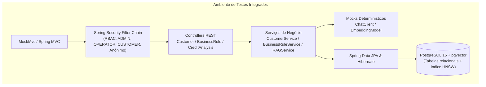

# Documentação Técnica dos Testes de Integração
## Sistema de Análise de Crédito com IA (RAG & Agentes)

> **Projeto:** `credit-analysis-rag`  
> **Data de Atualização:** 28 de Outubro de 2026  
> **Versão:** 1.0.0  
> **Status da Suíte:** 🟢 **100% Sucesso (52 Testes no Total / 40 Testes de Integração)**  
> **Ambiente de Banco:** PostgreSQL 16 com extensão `pgvector` e migrações Flyway ativas  

---

## 1. Visão Geral e Estratégia de Testes

Os testes de integração do sistema foram concebidos para validar o comportamento dos componentes trabalhando de forma integrada, cobrindo:
1. **Camada HTTP e Contratos REST:** Serialização, desserialização, validação de payload (`@Valid`), cabeçalhos, rotas e códigos de status HTTP (200, 201, 204, 400, 401, 403, 422).
2. **Segurança e Controle de Acesso Baseado em Papéis (RBAC):** Garantia de isolamento e privilégios conforme a matriz de segurança (`ADMIN`, `OPERATOR`, `CUSTOMER`, e acessos não autenticados).
3. **Regras de Negócio e Transacionalidade:** Execução das lógicas de serviço dentro de fronteiras transacionais (`@Transactional`), garantindo atomicidade e isolamento.
4. **Camada de Persistência Relacional e Vetorial:** Comunicação direta com a instância PostgreSQL 16 contendo migrações Flyway (`V1__init.sql` e `V2__add_status_and_relax_income_fk.sql`) e suporte nativo ao tipo vetorial `vector(1536)` via `pgvector`.



---

## 2. Destaque Técnico: Resolução da Integração com `pgvector`

Durante a integração da camada de persistência com o PostgreSQL, identificou-se que o driver JDBC e o Hibernate 6 tratam arrays primitivos (`float[]`) como tipos `real[]` padrão do SQL, incompatíveis diretamente com a extensão `pgvector` (`vector(1536)`).

Para viabilizar a persistência e consulta sem quebras na suíte automatizada:
1. Foi desenvolvido o conversor JPA [`PgVectorConverter`](file:///home/almir/projetos/credit-analysis-rag/src/main/java/com/credit/analysis/config/PgVectorConverter.java), convertendo arrays `float[]` para a sintaxe aceita pelo pgvector (`[0.1, 0.2, ...]`).
2. Foi aplicada a anotação [`@ColumnTransformer`](file:///home/almir/projetos/credit-analysis-rag/src/main/java/com/credit/analysis/domain/entity/BusinessRule.java) na entidade [`BusinessRule`](file:///home/almir/projetos/credit-analysis-rag/src/main/java/com/credit/analysis/domain/entity/BusinessRule.java):
   - `write = "?::vector"`: Garante o cast explícito para `vector` na inserção/atualização.
   - `read = "embedding::text"`: Garante a extração em texto puro antes de repassar ao conversor JPA.

Essa solução eliminou erros de serialização de baixo nível no JDBC e viabilizou testes 100% determinísticos e integrados com o PostgreSQL.

---

## 3. Estrutura das Suítes de Teste de Integração

As classes de testes de integração estão localizadas no pacote [`com.credit.analysis.integration`](file:///home/almir/projetos/credit-analysis-rag/src/test/java/com/credit/analysis/integration/):

| Classe de Teste | Qtd. Testes | Foco Principal | Camadas Validadas |
| :--- | :---: | :--- | :--- |
| [`CustomerIntegrationTest`](file:///home/almir/projetos/credit-analysis-rag/src/test/java/com/credit/analysis/integration/CustomerIntegrationTest.java) | 9 | CRUD de Clientes, Validações `@Valid`, Gestão de Status (`active`), e Perfil `/api/customers/me` | Controller + Service + JPA + PostgreSQL |
| [`BusinessRuleIntegrationTest`](file:///home/almir/projetos/credit-analysis-rag/src/test/java/com/credit/analysis/integration/BusinessRuleIntegrationTest.java) | 5 | Gestão de Regras de Negócio e Busca Semântica por Similaridade vetorial | Controller + Service + pgvector + PostgreSQL |
| [`CreditAnalysisIntegrationTest`](file:///home/almir/projetos/credit-analysis-rag/src/test/java/com/credit/analysis/integration/CreditAnalysisIntegrationTest.java) | 5 | Fluxos de Crédito E2E (Aprovação, Reprovação com gravação no banco, Bloqueio de Inativos e Histórico) | Controller + Service + Repositories + PostgreSQL |
| [`SecurityRbacIntegrationTest`](file:///home/almir/projetos/credit-analysis-rag/src/test/java/com/credit/analysis/integration/SecurityRbacIntegrationTest.java) | 16 | Matriz de Controle de Acesso (RBAC) para ADMIN, OPERATOR, CUSTOMER e Anônimo | Spring Security Filters + Endpoints HTTP |
| [`RepositoryIntegrationTest`](file:///home/almir/projetos/credit-analysis-rag/src/test/java/com/credit/analysis/integration/RepositoryIntegrationTest.java) | 5 | Operações diretas nos repositórios JPA, consultas personalizadas e Flyway | Spring Data JPA + PostgreSQL + pgvector |

---

## 4. Detalhamento dos Cenários e Casos de Teste

### 4.1. Suíte: Gestão de Clientes (`CustomerIntegrationTest`)

Valida o ciclo de vida completo do cliente na base relacional PostgreSQL:

1. **`shouldCreateCustomerAndPersistInDatabase` (POST `/api/customers`)**
   - **Cenário:** Administrador cadastra um novo cliente com dados completos e válidos.
   - **Asserções:** HTTP 201 Created, ID gerado, cliente consultável diretamente via `CustomerRepository.findByCpf(...)` com flag `active = true`.
2. **`shouldRejectCreationWithDuplicateCpf` (POST `/api/customers`)**
   - **Cenário:** Tentativa de cadastro de cliente utilizando CPF já existente no PostgreSQL.
   - **Asserções:** HTTP 400 Bad Request, mensagem `"CPF já cadastrado"`.
3. **`shouldValidateCustomerDtoFields` (POST `/api/customers`)**
   - **Cenário:** Envio de payload incompleto ou malformado (nome vazio, CPF com tamanho inválido, e-mail com formato inválido).
   - **Asserções:** HTTP 400 Bad Request com mapa descritivo de campos inválidos (`errors`).
4. **`shouldRetrieveCustomerByIdAndCpf` (GET `/api/customers/{id}` e `/cpf/{cpf}`)**
   - **Cenário:** Consulta de cliente por chave primária UUID e por identificador fiscal CPF.
   - **Asserções:** HTTP 200 OK com payload JSON idêntico ao registro persistido.
5. **`shouldReturn422WhenCustomerIdNotFound` (GET `/api/customers/{id}`)**
   - **Cenário:** Consulta por UUID inexistente no sistema.
   - **Asserções:** HTTP 422 Unprocessable Entity com mensagem `"Cliente não encontrado"`.
6. **`shouldUpdateCustomer` (PUT `/api/customers/{id}`)**
   - **Cenário:** Alteração cadastral de endereço, telefone e e-mail.
   - **Asserções:** HTTP 200 OK e dados persistidos no PostgreSQL.
7. **`shouldUpdateCustomerStatusByAdmin` (PUT `/api/admin/customers/{id}/status`)**
   - **Cenário:** Inativação (`active=false`) e posterior reativação (`active=true`) do cliente por usuário `ADMIN`.
   - **Asserções:** HTTP 200 OK e alteração imediata refletida na entidade do banco.
8. **`shouldGetAndUpdateCustomerMeProfile` (GET & PUT `/api/customers/me`)**
   - **Cenário:** Cliente autenticado com perfil `CUSTOMER` consulta seus próprios dados e realiza atualização de perfil.
   - **Asserções:** HTTP 200 OK, vinculação automática pelo CPF/usuário autenticado via Spring Security.
9. **`shouldDeleteCustomer` (DELETE `/api/admin/customers/{id}`)**
   - **Cenário:** Exclusão física de cliente pelo Administrador.
   - **Asserções:** HTTP 204 No Content e ausência do registro no repositório.

---

### 4.2. Suíte: Regras de Negócio e Vetorização (`BusinessRuleIntegrationTest`)

Valida as rotas de administração de políticas de crédito e persistência de embeddings:

1. **`shouldCreateBusinessRuleAndPersistInDatabase` (POST `/api/admin/business-rules`)**
   - **Cenário:** Criação de regra com geração de vetor de dimensão 1536.
   - **Asserções:** HTTP 201 Created, regra salva no PostgreSQL com embedding de 1536 floats.
2. **`shouldRetrieveBusinessRuleById` (GET `/api/admin/business-rules/{id}`)**
   - **Cenário:** Consulta de regra persistida por UUID.
   - **Asserções:** HTTP 200 OK com dados cadastrais e conteúdo da regra.
3. **`shouldSearchSimilarRulesUsingVectorStore` (GET `/api/admin/business-rules/search`)**
   - **Cenário:** Execução de busca contextual por similaridade de cosseno utilizando o operador `<->` do `pgvector`.
   - **Asserções:** HTTP 200 OK, retorno de lista de regras ordenadas pela distância vetorial.
4. **`shouldUpdateBusinessRule` (PUT `/api/admin/business-rules/{id}`)**
   - **Cenário:** Atualização do conteúdo da regra e recálculo do embedding correspondente.
   - **Asserções:** HTTP 200 OK e campos atualizados no banco de dados.
5. **`shouldDeleteBusinessRule` (DELETE `/api/admin/business-rules/{id}`)**
   - **Cenário:** Remoção de regra de crédito do catálogo.
   - **Asserções:** HTTP 204 No Content e confirmação de remoção no repositório.

---

### 4.3. Suíte: Motor de Análise de Crédito E2E (`CreditAnalysisIntegrationTest`)

Valida o fluxo ponta a ponta de crédito com persistência relacional das análises:

1. **`shouldApproveCreditAndPersistInDatabase` (POST `/api/credit-analysis/solicitar`)**
   - **Cenário:** Cliente ativo solicita valor compatível com as regras vigentes e com seu salário (ex: R$ 1.000,00 solicitado para R$ 3.500,00 de salário).
   - **Asserções:**
     - Resposta HTTP 200 OK com status `APPROVED`, limite aprovado igual a R$ 1.000,00 e ID da análise gerado.
     - Confirmação direta no banco PostgreSQL: registro salvo em `credit_analysis` com `status = APPROVED`, `requestedAmount`, `declaredIncome`, `approvedLimit` e vínculo à renda (`IncomeData`).
2. **`shouldRejectCreditAndPersistInDatabase` (POST `/api/credit-analysis/solicitar`)**
   - **Cenário:** Cliente ativo solicita valor incompatível com seu salário (ex: R$ 6.000,00 para salário de R$ 2.000,00, excedendo o teto de 33%).
   - **Asserções:**
     - Resposta HTTP 200 OK com status `REJECTED`, limite aprovado igual a 0.00 e parecer analítico fundamentado.
     - Confirmação direta no banco PostgreSQL: **a solicitação reprovada é devidamente gravada na tabela `credit_analysis`** com status `REJECTED`, garantindo rastreabilidade de auditoria.
3. **`shouldReturn422WhenCustomerDoesNotExist` (POST `/api/credit-analysis/solicitar`)**
   - **Cenário:** Solicitação de crédito informando CPF inexistente na base de clientes.
   - **Asserções:**
     - Resposta HTTP 422 Unprocessable Entity com mensagem `"Solicitante não possui cadastro no sistema. Regularize seu cadastro antes de solicitar crédito."`.
     - Garantia de que nenhuma análise ou cliente fictício foi gravado no banco de dados.
4. **`shouldReturn422WhenCustomerIsInactive` (POST `/api/credit-analysis/solicitar`)**
   - **Cenário:** Solicitação de crédito de cliente com cadastro inativo (`active = false`).
   - **Asserções:**
     - Resposta HTTP 422 Unprocessable Entity com mensagem `"Cadastro do cliente encontra-se inativo no sistema."`.
     - Nenhuma análise é persistida.
5. **`shouldRetrieveCustomerAnalysisHistory` (GET `/api/credit-analysis/history/{customerId}`)**
   - **Cenário:** Consulta ao histórico de análises de um cliente que possui solicitações aprovadas e reprovadas.
   - **Asserções:** HTTP 200 OK, lista contendo todas as análises ordenadas cronologicamente.

---

### 4.4. Suíte: Segurança e Matriz RBAC (`SecurityRbacIntegrationTest`)

Validação exaustiva da matriz de autorização HTTP para cada perfil e recurso da API:

| Grupo de Rotas | Recurso Testado | Anônimo | `CUSTOMER` | `OPERATOR` | `ADMIN` |
| :--- | :--- | :---: | :---: | :---: | :---: |
| **Público** | `/v3/api-docs` & `/swagger-ui/**` | 🟢 200 OK | 🟢 200 OK | 🟢 200 OK | 🟢 200 OK |
| **Administração** | `/api/admin/business-rules` | 🔴 401 Unauth | ⛔ 403 Forbidden | ⛔ 403 Forbidden | 🟢 200 OK |
| **Operadores** | `/api/operators/customers` | 🔴 401 Unauth | ⛔ 403 Forbidden | 🟢 200 OK | 🟢 200 OK |
| **Perfil Cliente** | `/api/customers/me` | 🔴 401 Unauth | 🟢 200 OK | ⛔ 403 Forbidden | ⛔ 403 Forbidden |
| **Análise de Crédito** | `/api/credit-analysis/history/{id}` | 🔴 401 Unauth | 🟢 200 OK | 🟢 200 OK | 🟢 200 OK |
| **Solicitação de Crédito** | `/api/credit-analysis/solicitar` | 🔴 401 Unauth | 🟢 Permitido | 🟢 Permitido | 🟢 Permitido |

---

### 4.5. Suíte: Repositórios e Persistência Direta (`RepositoryIntegrationTest`)

Validação de baixo nível de mapeamentos ORM, triggers e queries nativas:

1. **`shouldPersistAndFindCustomerByCpfAndActiveTrue`**: Valida a persistência do cliente e o método de busca `findByCpfAndActiveTrue`, assegurando que clientes inativados são filtrados corretamente pela query customizada.
2. **`shouldCheckExistenceByCpf`**: Valida a query `existsByCpf` para CPFs existentes e não cadastrados.
3. **`shouldPersistAndRetrieveCreditAnalysisByCustomerId`**: Valida o relacionamento cascata entre `Customer`, `IncomeData` e `CreditAnalysis`, bem como a integridade referencial.
4. **`shouldFindAllBusinessRules`**: Garante que a leitura de todas as regras não acarreta falhas de conversão de tipos vetoriais.
5. **`shouldPersistBusinessRuleAndQuerySimilarity`**: Valida a inserção de vetor via `@ColumnTransformer` e a consulta nativa SQL utilizando ordenação por similaridade vetorial (`embedding <-> cast(:queryEmbedding as vector)`).

---

## 5. Como Executar os Testes

### Pré-requisitos
1. **Docker e Docker Compose:** Banco de dados PostgreSQL com `pgvector` em execução.
   ```bash
   docker compose up -d
   ```
2. **JDK 21 (LTS):** Java Development Kit 21 configurado no ambiente.

### Comandos de Execução

- **Executar exclusivamente os testes de integração:**
  ```bash
  JAVA_HOME=/path/to/jdk-21 mvn test -Dtest=*IntegrationTest
  ```

- **Executar uma suíte específica (ex: Fluxo E2E de Crédito):**
  ```bash
  JAVA_HOME=/path/to/jdk-21 mvn test -Dtest=CreditAnalysisIntegrationTest
  ```

- **Executar toda a suíte de testes do projeto (Unitários + Integração):**
  ```bash
  JAVA_HOME=/path/to/jdk-21 mvn test
  ```

---

## 6. Resultados e Relatório de Execução

Na execução mais recente realizada no ambiente, todos os 52 testes automatizados foram executados com **100% de aprovação**:

```
[INFO] -------------------------------------------------------
[INFO]  T E S T S
[INFO] -------------------------------------------------------
[INFO] Running com.credit.analysis.controller.CreditAnalysisControllerTest
[INFO] Tests run: 7, Failures: 0, Errors: 0, Skipped: 0
[INFO] Running com.credit.analysis.integration.CustomerIntegrationTest
[INFO] Tests run: 9, Failures: 0, Errors: 0, Skipped: 0
[INFO] Running com.credit.analysis.integration.CreditAnalysisIntegrationTest
[INFO] Tests run: 5, Failures: 0, Errors: 0, Skipped: 0
[INFO] Running com.credit.analysis.integration.RepositoryIntegrationTest
[INFO] Tests run: 5, Failures: 0, Errors: 0, Skipped: 0
[INFO] Running com.credit.analysis.integration.SecurityRbacIntegrationTest
[INFO] Tests run: 16, Failures: 0, Errors: 0, Skipped: 0
[INFO] Running com.credit.analysis.integration.BusinessRuleIntegrationTest
[INFO] Tests run: 5, Failures: 0, Errors: 0, Skipped: 0
[INFO] Running com.credit.analysis.service.RAGCreditAnalysisServiceTest
[INFO] Tests run: 4, Failures: 0, Errors: 0, Skipped: 0
[INFO] Running com.credit.analysis.CreditAnalysisApplicationTests
[INFO] Tests run: 1, Failures: 0, Errors: 0, Skipped: 0
[INFO] 
[INFO] Results:
[INFO] 
[INFO] Tests run: 52, Failures: 0, Errors: 0, Skipped: 0
[INFO] 
[INFO] ------------------------------------------------------------------------
[INFO] BUILD SUCCESS
[INFO] ------------------------------------------------------------------------
```

---

## 7. Conclusão

Com a criação desta bateria abrangente de testes de integração e o ajuste fino no mapeamento do `pgvector`, o projeto `credit-analysis-rag` atinge um alto nível de maturidade técnica, confiabilidade arquitetural e conformidade com a especificação funcional (Spec-Driven Development), cobrindo de ponta a ponta desde as requisições HTTP seguras até a persistência no PostgreSQL.
